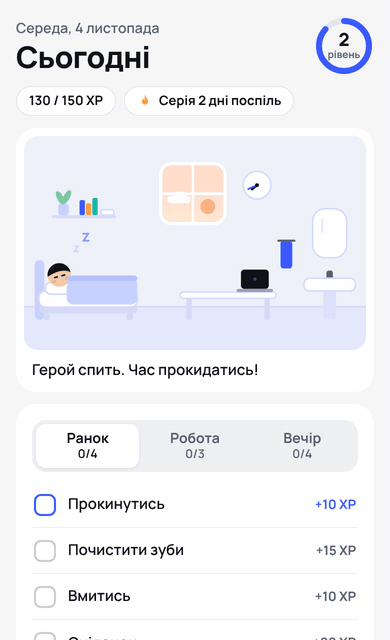

# Гра про життя

Мінімалістична PWA-гра для iPhone: герой повторює твою реальну рутину. Прокинувся — він потягується
біля ліжка, почистив зуби — йде до умивальника й чистить зуби, і за кожну справу отримує досвід.
Нагадування за розкладом приходять пуш-сповіщеннями з власного сервера на ASP.NET Core.



**Стек:** Angular 22 (standalone, signals, zoneless), Canvas 2D (векторна графіка з інверсною кінематикою рук), Service Worker, Web Push ·
ASP.NET Core 10 Minimal API · Vitest · GitHub Actions + GitHub Pages.

## Можливості

- **Сцена** в пласкому мінімалістичному стилі, намальована кодом: ліжко, стіл, ноутбук, умивальник. Вікно показує
  ранок, день, вечір чи ніч за твоїм часом, годинник на стіні — реальний час.
- **8 анімацій:** прокинутись, почистити зуби, вмитись, поїсти, робота, навчання, розминка,
  лягти спати. Перед кожною дією герой сам іде до потрібного місця, після «Лягти спати» — спить.
- **Квести** «Ранок», «Робота» і «Вечір»: досвід, рівні, бонус за квест, серія днів,
  характеристики (Сила, Інтелект, Енергія, Дисципліна, Робота).
- **Список справ:** разові справи на сьогодні, завтра, будь-яку дату чи «колись», з часом і
  нагадуванням «за 5 хв … за 1 день» (напр. «Стрижка о 14:00, нагадати за 30 хв»).
  Прострочені підсвічуються, за кожну виконану — +10 XP, значок у меню показує справи на сьогодні.
- **Нагадування:** свій час для кожного квесту; сервер не нагадує про вже виконані квести;
  сповіщення відкриває одразу потрібний квест або список справ.
- **Будильник:** інструкція для автоматизації iOS «Коли будильник зупинено → відкрити гру».
- Скасування випадково відміченої справи, 8-бітні звуки, резервна копія прогресу у файл.
- Працює офлайн, встановлюється на головний екран.

## Структура

```
src/app/
  game/        квести, рівні й серії (чисті функції), стан гри на signals, звуки
  scene/       пласкі кімната й герой (пози через інверсну кінематику), ігровий цикл
  reminders/   конфіг сервера, підписка на push і синхронізація розкладу
  screens/     «Сьогодні», «Справи», «Нагадування», «Герой»
server/        сервер нагадувань на ASP.NET Core (див. server/README.md)
docs/          демо для README
```

## Запуск

```bash
npm install
npm start          # http://localhost:4200
npm test           # юніт-тести фронтенду
npm run build      # продакшн-збірка в dist/life-game/browser
```

Service Worker і пуш-сповіщення працюють лише в продакшн-збірці.
Сервер: `dotnet run --project server/src/LifeGame.Push` (потрібен .NET 10 SDK).

## Публікація на GitHub Pages

1. Створи **публічний** порожній репозиторій `life-game` на GitHub.
2. У цій папці:

   ```bash
   git remote add origin https://github.com/<логін>/life-game.git
   git push -u origin main
   ```

3. **Settings → Pages → Source: GitHub Actions.** Workflow прожене тести й опублікує гру на
   `https://<логін>.github.io/life-game/`.
4. На iPhone: Safari → «Поділитися» → «На початковий екран».

## Увімкнути нагадування

1. Розгорни сервер (варіанти в [server/README.md](server/README.md)) з
   `Push__AllowedOrigins__0=https://<логін>.github.io`.
2. Впиши його адресу в `public/config.json` → `"apiUrl"` і запуш, або введи на екрані
   «Нагадування» → «Сервер».
3. У грі з головного екрана: «Нагадування» → «Увімкнути» → «Тестове».

На iPhone пуш-сповіщення від сайтів працюють лише для гри, встановленої на головний екран
(iOS 16.4+). Справжній будильник сайт зробити не може — тому будильник лишається в «Годиннику»,
а гру відкриває автоматизація «Команд» (інструкція є в самій грі).

## Тести

| Що | Команда |
| --- | --- |
| Логіка гри, нагадування (Vitest) | `npm test` |
| Сервер: планувальник, шифрування, VAPID, валідація | `dotnet run --project server/tests/LifeGame.Push.Tests` |
| Сервер e2e: справжній сервер + фейковий push-сервіс + розшифрування `http_ece` | `npm ci --prefix server/e2e && npm test --prefix server/e2e` |

## Як додати нову справу

1. Додай справу в `QUESTS` у `src/app/game/quests.ts` (назва, XP, характеристика, місце в кімнаті).
2. Нова анімація: `ActionKind`, тривалість у `ACTION_DURATION` і поза в `SceneEngine.pose()`.
   Пози задаються цілями для кистей і стоп у `src/app/scene/flat.ts` (`FlatPose`).

## Далі

- Реалістичний персонаж із власного фото: AI-відеокліпи замість намальованих анімацій.
- Редактор власних рутин.
- Пристрій на ESP32 з екраном і динаміком: справжній будильник, на якому живе герой.
